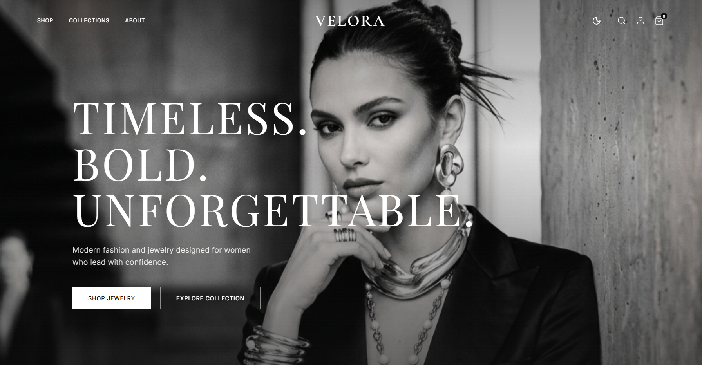
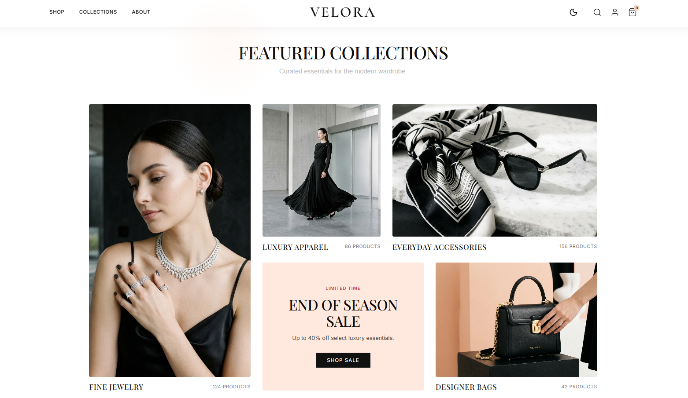
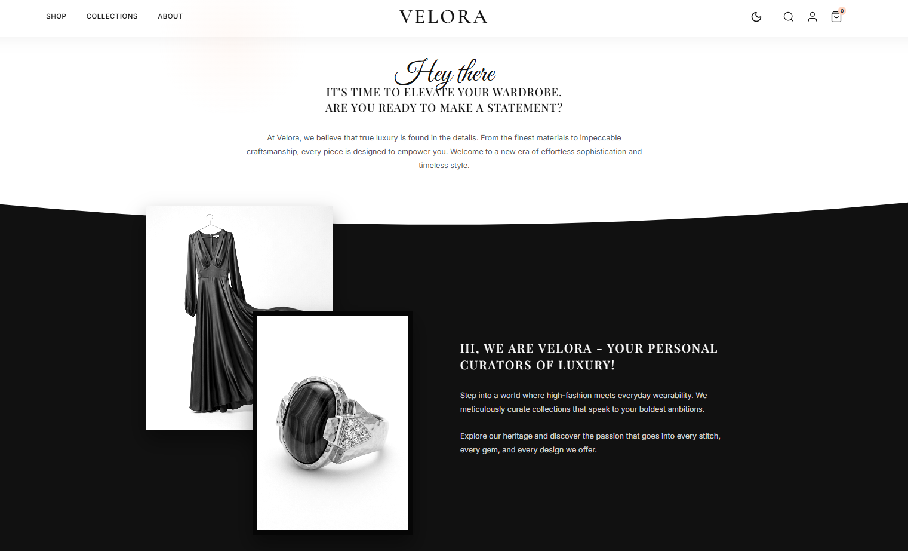
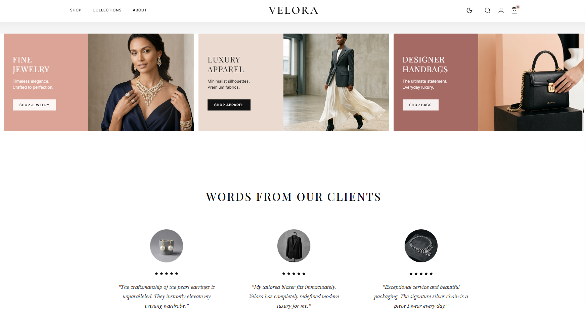
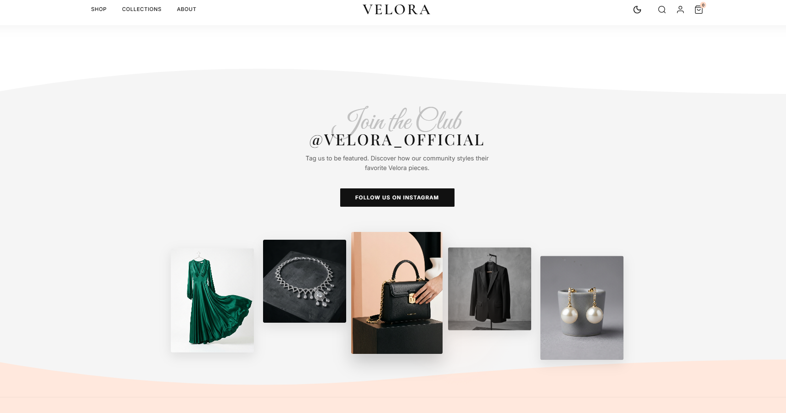

<div align="center">

  # ✦ V E L O R A ✦
  ### Luxury Fashion & Haute Couture E-Commerce Experience

  <p align="center">
    <strong>An editorial-grade, motion-driven luxury e-commerce web application crafted with React 19, Vite, and Framer Motion.</strong>
  </p>

  <p align="center">
    <a href="https://github.com/Komalgiri/Velora">
      
    </a>
    <a href="https://vitejs.dev/">
      
    </a>
    <a href="https://www.framer.com/motion/">
      
    </a>
    <a href="https://developer.mozilla.org/en-US/docs/Web/CSS">
      
    </a>
    <a href="https://oxc.rs/">
      
    </a>
    <a href="https://vercel.com">
      
    </a>
  </p>

  <p align="center">
    <a href="#-ui--visual-showcase">Visual Showcase</a> •
    <a href="#-portfolio--recruiter-highlights">Portfolio Highlights</a> •
    <a href="#-key-features">Key Features</a> •
    <a href="#-uiux--design-system">Design System</a> •
    <a href="#-technical-architecture">Architecture</a> •
    <a href="#-quick-start">Quick Start</a> •
    <a href="#-available-for-hire">Hire Me</a>
  </p>

  <br />

  <p align="center">
    
  </p>

</div>

---

## 📸 UI & Visual Showcase

A curated walkthrough of VELORA's editorial layout, typographic hierarchy, and responsive UI components:

### 1. Hero Landing & Brand Identity
> *High-contrast monochrome art direction with fluid typography (`clamp()`), floating glassmorphic navigation, and smooth call-to-action hover interactions.*

<p align="center">
  
</p>

---

### 2. Curated Collections & Editorial Grid
> *Asymmetric multi-column masonry showcasing jewelry, apparel, and bespoke accessories with integrated promotional cards and hover overlays.*

<p align="center">
  
</p>

---

### 3. Atelier Brand Story & Seamless Wave Transition
> *Organic SVG curve transition shifting from high-key white into atelier noir styling, accompanied by floating, staggered product photography and typography.*

<p align="center">
  
</p>

---

### 4. Lookbook Spreads & Client Accolades
> *Warm editorial split-banner banners highlighting seasonal collections, seamlessly paired with social proof testimonials and 5-star rating badges.*

<p align="center">
  
</p>

---

### 5. Instagram Community & VIP Club
> *Interactive lifestyle gallery showcasing social media integration, curated product highlights, and community invitation.*

<p align="center">
  
</p>

---

## 🌟 Executive Overview

**VELORA** is an editorial-first e-commerce web application inspired by high-end couture houses and luxury magazines (Vogue, Cartier, Saint Laurent). Built to demonstrate **advanced frontend engineering**, **pixel-perfect UI execution**, and **fluid micro-interactions**, this project showcases the ability to translate complex, high-fashion art direction into smooth, high-performance web software.

Unlike standard template-based storefronts, VELORA is styled entirely using **bespoke Vanilla CSS and design tokens**—demonstrating a deep command of modern layout mechanics (CSS Grid, Flexbox, Fluid Typography, dynamic theme variables) without relying on heavyweight UI component kits.

---

## 💼 Portfolio & Recruiter Highlights

> **Target Audience:** Freelance Clients, Frontend Engineering Leads, and Product Designers looking for a frontend developer who combines engineering rigor with aesthetic intuition.

| Skill Area | Implementation in VELORA |
| :--- | :--- |
| **Micro-Animations & Physics** | Custom spring-interpolated cursor glow aura, scroll-triggered reveals (`IntersectionObserver`), staggered hero entrances, and continuous marquee ribbons. |
| **State Architecture** | Decoupled global cart and dynamic theme contexts with zero unnecessary re-renders, optimistic item mutations, and persistent badge counts. |
| **Bespoke Styling Mastery** | 100% custom CSS with semantic tokens, zero generic bootstrap/Tailwind styling; mastered fluid typography using `clamp()`, negative margins, and editorial whitespace. |
| **Interactive UX Details** | Interactive product zoom lens calculating mouse coordinates in real-time, slide-over drawer cart with backdrop blur, variant selectors, and live order calculation. |
| **Performance & Code Quality** | Built on React 19 + Vite for sub-millisecond HMR; linted with next-gen Oxlint engine for ultra-clean, production-ready code. |
| **Complete User Journeys** | End-to-end shopping simulation: Editorial Landing ➔ Filterable Collection ➔ Product Detail Zoom ➔ Slide Drawer ➔ Checkout Summary ➔ VIP Member Profile. |

---

## ✨ Key Features

### 1. 🛍️ End-to-End E-Commerce Flow
- **Interactive Slide-Out Cart Drawer (`CartDrawer`):** Slide-over drawer with glassmorphism backdrop, live quantity increment/decrement, dynamic subtotal calculations, promo code input, and seamless transition to checkout.
- **Product Filtering & Sorting (`Shop`):** Filter luxury catalog by categories (Jewelry, Fashion, Accessories) and sort by featured status with instant UI feedback.
- **Interactive Product Detail Experience (`Product`):**
  - **Dynamic Zoom Lens:** Real-time mouse coordinate tracking (`onMouseMove`) to zoom into high-resolution fabric and jewelry details.
  - **Variant Switchers:** Color selection, size selection, and interactive thumbnail gallery switching.
- **Full Checkout Flow (`Checkout`):** Clean, distraction-free checkout page with form fields for contact info, shipping, payment methods, and live itemized order total.
- **VIP Customer Portal (`Profile`):** Custom account dashboard featuring order tracking (`#VLR-98244`), tier status (*Black Tier Member*), order history, and account settings.

### 2. 🎨 Luxury Editorial Aesthetic & Motion
- **Fluid Cursor Aura (`CursorGlow`):** Smooth, spring-physics radial light follow-effect powered by Framer Motion.
- **Animated Route Transitions (`AnimatedPage`):** Seamless page-to-page fade and lift animations across React Router navigation.
- **Scroll-Triggered Reveals (`ScrollReveal`):** Viewport-based staggered entrance animations giving sections a curated, runway-reveal feel.
- **Infinite Marquee Banner (`WavyBanner`):** Seamless rolling luxury slogan ticker across screen boundaries.
- **Sticky Blur Navigation (`Navbar`):** Dynamic transparent-to-solid glassmorphism transition triggered on scroll.

### 3. 🌓 Dynamic Light / Dark Theming
- Integrated `ThemeContext` enabling instantaneous switching between **High-Key Editorial White** and **Atelier Noir Dark Mode**.
- CSS Custom Property switching across root variables (`--primary-black`, `--pure-white`, `--peach-accent`).
- Smart media filtering: Automatically adjusts image contrast and brightness in dark mode to preserve high-fashion photographic balance.

---

## 🎨 UI/UX & Design System

VELORA follows a deliberate minimalist luxury design language grounded in classic print typography and generous negative space:

### Typography
- **Headings & Editorial Titles:** [`Playfair Display`](https://fonts.google.com/specimen/Playfair+Display) & [`Cormorant Garamond`](https://fonts.google.com/specimen/Cormorant+Garamond) (High-contrast serifs with refined elegance)
- **Body & Interface Elements:** [`Inter`](https://fonts.google.com/specimen/Inter) & [`Manrope`](https://fonts.google.com/specimen/Manrope) (Clean, neutral geometric sans for effortless legibility)

### Palette
```
┌───────────────────┬───────────────────┬───────────────────┐
│ Primary Black     │ Pure White        │ Luxury Peach      │
│ #111111           │ #FFFFFF           │ #FFD6C2           │
├───────────────────┼───────────────────┼───────────────────┤
│ Soft Neutral      │ Studio Silver     │ Atelier Bronze    │
│ #F5F5F5           │ #C0C0C0           │ #C6A56E           │
└───────────────────┴───────────────────┴───────────────────┘
```

---

## 🏗️ Technical Architecture

### Component Hierarchy & File Structure

```text
VELORA/
├── public/                 # Static assets, favicon, SVGs
├── src/
│   ├── assets/             # Curated fashion, jewelry & editorial photography
│   │   └── screenshots/    # UI preview captures for documentation & showcase
│   ├── components/         # Modular, reusable presentation & layout components
│   │   ├── AnimatedPage.jsx   # Framer Motion page transition wrapper
│   │   ├── BestSellers.jsx    # Curated product showcase grid
│   │   ├── BrandStory.jsx     # Atelier narrative & craftsmanship layout
│   │   ├── CartDrawer.jsx     # Slide-over cart panel with quantity actions
│   │   ├── Collections.jsx    # Category discovery cards with zoom effects
│   │   ├── CursorGlow.jsx     # Physics-driven custom radial cursor
│   │   ├── Footer.jsx         # Multi-column luxury footer
│   │   ├── Hero.jsx           # Editorial high-impact entrance section
│   │   ├── Instagram.jsx      # Social editorial lookbook grid
│   │   ├── Lookbook.jsx       # Fashion house editorial spread
│   │   ├── Navbar.jsx         # Sticky navigation with theme toggle & cart badge
│   │   ├── NewArrivals.jsx    # Seasonal drops with quick-add actions
│   │   ├── Newsletter.jsx     # VIP invitation newsletter form
│   │   ├── Reviews.jsx        # Press accolades & customer testimonials
│   │   ├── ScrollReveal.jsx   # Viewport intersection animation wrapper
│   │   ├── WavyBanner.jsx     # Infinite marquee ticker
│   │   └── WhyVelora.jsx      # Core brand pillars & guarantees
│   ├── context/            # React Context state management
│   │   ├── CartContext.jsx    # Global cart state, item mutations, drawer toggle
│   │   └── ThemeContext.jsx   # Dark / light theme toggle and body class hook
│   ├── pages/              # Routed view controllers
│   │   ├── Checkout.jsx       # Order summary, address & payment forms
│   │   ├── Home.jsx           # 10-section landing page experience
│   │   ├── Product.jsx        # Detail view with interactive zoom lens
│   │   ├── Profile.jsx        # VIP customer account portal & order history
│   │   ├── Search.jsx         # Search overlay experience
│   │   └── Shop.jsx           # Filterable, sortable catalog grid
│   ├── App.jsx             # Route definitions & provider assembly
│   ├── index.css           # Global typography, color tokens, and base styles
│   └── main.jsx            # React 19 root mounting
├── vercel.json             # SPA routing rewrite rules for production
├── vite.config.js          # Vite build & bundler configuration
└── package.json            # Scripts & project dependencies
```

---

## ⚡ Tech Stack & Libraries

- **Core Library:** [React 19](https://react.dev/) (Modern hooks: `useState`, `useEffect`, `useContext`, custom hooks)
- **Tooling & Build:** [Vite](https://vitejs.dev/) (Next-generation lightning-fast bundler)
- **Animations:** [Framer Motion](https://www.framer.com/motion/) (Declarative page transitions and mouse-follow glow)
- **Routing:** [React Router v7](https://reactrouter.com/) (Declarative SPA routing with dynamic parameters)
- **Icons:** [Lucide React](https://lucide.dev/) (Crisp, modern, lightweight SVG icons)
- **Static Analysis:** [Oxlint](https://oxc.rs/) (Next-generation high-speed linter)
- **Styling:** Bespoke Vanilla CSS with CSS Custom Properties (Variables), Flexbox, CSS Grid, and media queries

---

## 🚀 Quick Start

### Prerequisites
- [Node.js](https://nodejs.org/) (version 18+ recommended)
- `npm` or `yarn` / `pnpm`

### Installation

1. **Clone the repository:**
   ```bash
   git clone https://github.com/Komalgiri/Velora.git
   cd Velora
   ```

2. **Install dependencies:**
   ```bash
   npm install
   ```

3. **Start the local development server:**
   ```bash
   npm run dev
   ```
   Open [http://localhost:5173](http://localhost:5173) in your browser to experience the site with instant Hot Module Replacement (HMR).

4. **Lint the project:**
   ```bash
   npm run lint
   ```

5. **Build for production:**
   ```bash
   npm run build
   ```

---

## 💼 Available for Freelance & Full-Time Roles

Looking for a frontend developer who can turn ambitious designs into living, responsive, high-converting digital products?

### What I Bring to Your Team or Project:
- **Design-to-Code Precision:** Translating Figma / Adobe XD / Sketch mockups into pixel-perfect, responsive code.
- **Custom E-Commerce & Web Applications:** Building fast, intuitive, and conversion-optimized storefronts and SaaS platforms.
- **Motion & Micro-Interactions:** Elevating standard web apps with purposeful, silky-smooth animations that don't compromise performance.
- **Clean, Maintainable Architecture:** Writing modular, well-documented, scalable code that your team will love maintaining.

### Connect With Me:
- **GitHub:** [@Komalgiri](https://github.com/Komalgiri)
- **Project Repository:** [Velora on GitHub](https://github.com/Komalgiri/Velora)
- **Open for:** Frontend Developer Roles, Fullstack Opportunities, Freelance Contracts, and UI/UX Engineering Collaborations.

---

<div align="center">
  <sub>Crafted with passion for editorial aesthetics and modern frontend engineering. © 2026 VELORA.</sub>
</div>
